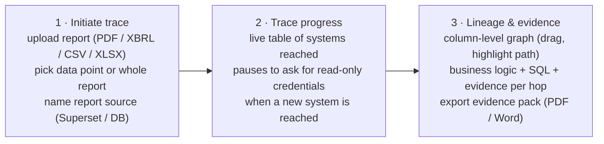
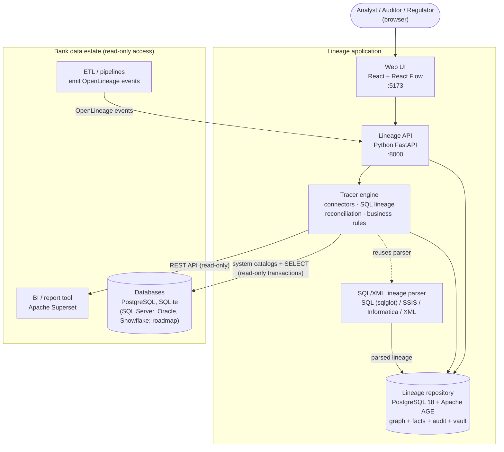
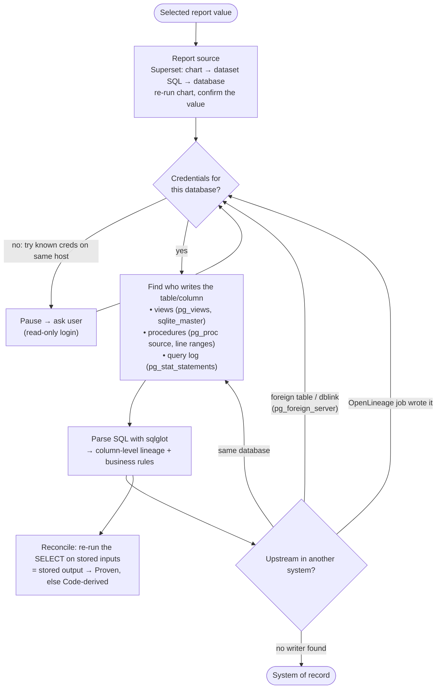

# Regulatory Lineage — Architecture & Product Overview

> **Audience:** senior architects, product managers, risk/regulatory reporting leads.
> **Status:** working proof of concept (POC), October 2026. Runs entirely on one laptop against a realistic sandbox estate.

---

## 1. The problem

Banks submit regulatory reports (COREP, FINREP, FRTB, internal Enterprise Financial Risk packs). Supervisors increasingly ask a simple question about any number in those reports:

> *"Where did this number come from, what happened to it on the way, and can you prove it?"*

**BCBS 239** (Basel Committee — *Principles for effective risk data aggregation and risk reporting*) makes this an obligation: risk reports must be **accurate, complete, reconcilable**, and every figure must be **traceable to source data** (Principles 3–6).

Today this is answered by hand: analysts read ETL code, stored procedures and spreadsheets, then assemble an evidence pack. It is slow (days per question), expensive, and the answer is stale the moment code changes.

## 2. What this product does

Two cooperating capabilities:

| Capability | What it does | Who uses it |
|---|---|---|
| **Lineage Tracer** (home page) | Upload a report → pick a number (or the whole report) → name the system the report came from. The tracer then **discovers** the lineage live, system by system, by reading each system's metadata read-only, until it reaches the systems of record. Every hop is marked **Proven**, **Code-derived** or **Unresolved**, with evidence. | Reporting analysts, data owners, auditors |
| **Lineage Explorer** (`/explorer`) | A governed **lineage repository** view: report cell → hop graph → transformations → value waterfall → record drill-down → regulator view → evidence pack, plus coverage/certification/audit and forward impact analysis. | Regulators (read-only, masked), Head of Regulatory Reporting, change teams |

The Tracer is the **discovery engine**; what it finds is written into the same graph repository the Explorer reads.

### Key outcomes
- **Minutes, not days** to answer "where did this number come from".
- **Evidence, not opinion**: each hop carries the actual code location, a definition fingerprint, the query-log entry and a reconciliation result.
- **Business-readable**: rules such as *"EAD (USD) = Drawn balance × FX rate + CCF × Undrawn commitment"*, derived deterministically from SQL and the data glossary — no AI guesswork in the evidence.
- **Column-level lineage**, OpenMetadata-style, for every value column.

---

## 3. User journey (Lineage Tracer)



1. **Initiate.** The user uploads the report exactly as delivered (e.g. the COREP C90 PDF or the EFR Credit Risk Summary PDF). The reader extracts the header (report, entity, date) and the table. The user clicks a cell (*data-point mode*) or chooses *Trace whole report*, then states where the report was produced (e.g. Superset URL + read-only login).
2. **Trace.** The tracer walks upstream. Each row in the progress table is a system it connected to. If it reaches a system it has no credentials for, it **pauses** and asks for read-only credentials (it first tries credentials already known for the same server).
3. **Lineage & evidence.** An interactive column-level graph. Click a column to highlight its full upstream/downstream path; click an edge to see the hop's business logic, transformation SQL and evidence; export a watermarked, hashed evidence pack.

---

## 4. System context



---

## 5. How discovery works (the core idea)

The tracer does what **OpenMetadata** and **DataHub** ingestion connectors do, but on demand and for one number:



**Strategies for finding the next hop**, strongest first:

| Evidence | Where it lives | Example |
|---|---|---|
| View definition | `pg_views`, `sqlite_master` | `rpt.v_efr_credit_risk_summary` adds the GROUP total row |
| Stored procedure body | `pg_proc.prosrc` (statement + line range) | `etl.sp_load_core_fact_exposure` computes EAD |
| Query log | `pg_stat_statements` | proves the INSERT actually ran (call count) |
| Cross-system link | `pg_foreign_server` / `pg_foreign_table` | staging reads `loans_db.los.facility` |
| Pipeline metadata | **OpenLineage** events from ETL tools | SQLite FX feed → `staging.ref_fx_rates` |
| BI metadata | Superset REST API | chart → dataset SQL → database connection |

**Hop status (the trust model):**

| Status | Meaning | How decided |
|---|---|---|
| **Proven** | Logic found **and** re-running it on the stored inputs reproduces the stored output (within tolerance) | Read-only re-execution of the discovered SELECT |
| **Code-derived** | Logic found, but it does not reconcile (data changed since load, restated inputs) or cannot be re-run (e.g. external ETL) | Reason recorded in the evidence |
| **Unresolved** | No logic found | Flagged for the data owner |

We demonstrated this with a tamper test: changing one source trade by +100 immediately turned that hop from Proven to Code-derived.

---

## 6. Components

### 6.1 Frontend — `web/`
| Item | Choice | Why |
|---|---|---|
| Framework | **React 19 + TypeScript**, built with **Vite** | Mainstream, fast dev loop, typed API contract |
| Lineage graph | **React Flow** (`@xyflow/react`) + **ELK** layered layout (in a web worker) | Same approach as OpenMetadata's lineage UI; draggable nodes, per-column handles, handles 100+ edges |
| Charts | Recharts (value waterfall) | Lightweight |
| Styling | Plain CSS design tokens; self-hosted fonts | No CDN dependency; works offline / in a bank network |
| Routing | `/` Tracer (3 screens), `/explorer/*` Explorer (S01–S12) | Tracer is the primary product; Explorer is the repository view |

Key files: `web/src/tracer/` (Initiate, Progress, Lineage, `LineageGraph.tsx`), `web/src/screens/` (Explorer screens), `web/src/api.ts`, `web/src/tracer/api.ts`.

### 6.2 Backend API — `src/lineage_api/`, `src/lineage_tracer/api.py`
- **FastAPI** (Python 3.12). One process serves the Explorer API (`/api/...`) and the Tracer API (`/api/tracer/...`).
- Contracts: `docs/spec/api.md` (Explorer), `docs/spec/tracer-api.md` (Tracer).
- Main Tracer routes: `POST /reports`, `POST /traces`, `GET /traces/{id}`, `POST /traces/{id}/connections`, `GET /traces/{id}/lineage`, `POST /traces/{id}/evidence-pack`, `GET|DELETE /systems`.
- **Why Python:** shares one codebase with the lineage parser and the Python data ecosystem (sqlglot, psycopg, reportlab, pymupdf).

### 6.3 Tracer engine — `src/lineage_tracer/`
| Module | Responsibility |
|---|---|
| `report_reader.py` | Reads the uploaded report: PDF tables (pymupdf word positions), XBRL facts (lxml), CSV/XLSX |
| `connectors/superset.py` | Superset REST: login → find chart → dataset SQL → database → re-run chart data |
| `connectors/postgres.py` | Catalog scanning (views, procedures, query log, foreign tables, comments); every session `read only` + statement timeout |
| `connectors/sqlite.py` | `sqlite_master` scanning |
| `sql_lineage.py` | Column-level lineage per statement via **sqlglot** (composes through CTEs) |
| `business_rules.py` | Deterministic plain-English rules from the SQL AST + glossary terms (arithmetic, lookups, filters, aggregation, scaling, total rows) |
| `reconcile.py` | Re-runs discovered SELECTs read-only and compares with stored values (row, column-total or row-count) |
| `tracer.py` | Orchestrator: breadth-first walk, pause/resume, hop numbering (source → report), persistence |
| `vault.py` | Credentials encrypted with Fernet; never returned by the API; reuse across same host |
| `pack.py` | Trace evidence pack (PDF/Word) |

### 6.4 Lineage repository & governance — `src/lineage_store/`
- **PostgreSQL 18 + Apache AGE** (graph extension). Graph `lineage` holds nodes/edges (systems, datasets, fields, jobs, rules, report cells) with validity dates for point-in-time lineage; relational tables hold run facts, record provenance, snapshots, evidence packs, audit log, tracer state and the credential vault.
- `audit.py`: append-only, **hash-chained** audit log (tamper-evident; every connection, reveal and export is logged).
- `masking.py`: identifiers masked by role; regulator role can never reveal. A read-only `lineage_agent` DB role sees only masked views (ready for future AI agents).
- `ingest_sql.py`, `ingest_ol.py`: ingest SQL/XML parser results and **OpenLineage** events into the graph.
- `evidence.py`, `packs.py`, `snapshot.py`, `regulator.py`, `impact.py`: Explorer features (immutable snapshots at submission, regulator narrative, forward impact/what-if).

### 6.5 SQL/XML lineage parser — `src/lineage_parser/`
The built-in SQL/XML lineage parser: a deterministic parser that extracts source-to-target lineage from **SQL (via sqlglot), SSIS (.dtsx), Informatica PowerCenter and generic XML** into a common `LineageGraph`. The Tracer reuses its SQL parser; the Explorer uses it to load attribute-level lineage.

---

## 7. Databases and systems in the POC

All run locally inside **WSL2 Ubuntu 24.04** (disk on `D:`), reachable from Windows on `127.0.0.1`.

| System | Technology | Port | Role |
|---|---|---|---|
| Lineage repository | PostgreSQL 18 + Apache AGE 1.8 (db `lineage`) | 5432 | Graph + facts + audit + vault + tracer state |
| Sandbox estate #1 | PostgreSQL 18 (8 databases) | 5432 | Multi-system bank: `loans_db`, `collateral_db`, `trading_db`, `staging`, `dwh`, `sa_engine`, `frtb_engine`, `reporting_db` — linked by foreign tables and PL/pgSQL procedures |
| FX feed | SQLite file (`market_data.db`) | — | External system of record; its load emits an OpenLineage event |
| Financial data lake | PostgreSQL 18 cluster `finlake` (db `fin_lake`) | 5433 | `raw → stg → core (fact/dim) → rpt` in one database; business glossary as column comments |
| Report tool | **Apache Superset 6.1** | 8088 | Charts "COREP C90 Report", "C 07.00 Corporates", "EFR Credit Risk Summary" |
| Lineage API | FastAPI / uvicorn | 8000 | |
| Web UI | Vite dev server | 5173 | |

### Demo reports (in `sandbox/reports/`)
| Report | Path traced | Result |
|---|---|---|
| **EFR Credit Risk Summary** (BCBS 239) — ENT-UK · Corporates · EAD 1,277.32 USD m | Superset → `rpt` view → `rpt` table → `core.fact_exposure` (+ dims) → `stg` → `raw` | 28 hops · 27 proven · 1 code-derived (FX restated after load) · 119 column edges |
| **COREP C90** — FX · DELTA 3,867.06 USD | Superset → `reporting_db` → `frtb_engine` → `dwh` → `staging` → `trading_db` + SQLite FX | 9 hops · 8 proven · 1 code-derived |
| **COREP C 07.00** — Corporates exposure value 1,240.5 EUR m (XBRL) | `reporting_db` → `sa_engine` → `dwh` → `staging` → `loans_db`, `collateral_db`, FX | 10 hops · 7 proven · 3 code-derived; pauses once for `loans_db` credentials |

### EFR data model (financial data lake)
```text
raw   entity · counterparty · rating · loan_contract · collateral · credit_limit · fx_rate · gl_balance
  │   typing, cleaning, de-duplication                      (etl.sp_load_stg_*)
stg   entity · counterparty · rating · loan · collateral · credit_limit · fx_rate
  │   star schema                                            (etl.sp_load_core_*)
core  dim_date · dim_entity · dim_counterparty · dim_rating · dim_product
      fact_exposure  (EAD = drawn + CCF × undrawn; RWA = EAD × RW; EL = PD × LGD × EAD; USD; intragroup excluded)
      fact_limit
  │   aggregate by entity × portfolio, USD m                 (etl.sp_load_rpt_efr)
rpt   efr_credit_risk_summary → v_efr_credit_risk_summary (+ GROUP total, utilisation %) → Superset chart
```

---

## 8. End-to-end sequence (data-point trace)

```mermaid
sequenceDiagram
    actor U as Analyst
    participant W as Web UI
    participant A as Lineage API
    participant T as Tracer
    participant S as Superset
    participant D as Databases
    participant R as Repository

    U->>W: Upload EFR PDF, click 1,277.32, Superset + login
    W->>A: POST /reports, POST /traces
    A->>T: start trace (background)
    T->>S: chart → dataset SQL → DB connection
    T->>S: re-run chart data, confirm 1,277.32 (Proven)
    T->>D: connect fin_lake (no creds → try same-host creds)
    T->>D: pg_views / pg_proc / pg_stat_statements / comments
    T->>T: sqlglot column lineage + business rules
    T->>D: re-run SELECT read-only → reconcile
    loop until systems of record
        T->>D: next table upstream
    end
    T->>R: store hops, column edges, evidence; audit log
    W->>A: GET /traces/{id}, GET /lineage (poll)
    U->>W: click column / edge → business logic + evidence
    U->>A: POST /evidence-pack → PDF (hashed, watermarked)
```

---

## 9. Key design decisions (and why)

| Decision | Alternatives considered | Why we chose it |
|---|---|---|
| **Discover lineage live from system metadata** | Manually documented lineage; ETL-tool-only lineage | Always current; works across tools; evidence comes from the systems themselves |
| **PostgreSQL + Apache AGE** for the repository | Neo4j, JanusGraph, Memgraph, ArangoDB | AGE is Apache-2.0 under the Apache Software Foundation (no vendor lock-in or paid tier), actively released; graph (Cypher) and relational facts in **one engine** — one backup, one HA story, one transaction, Postgres row-level security for masking. Neo4j's clustering/RBAC are paid; Memgraph/ArangoDB moved to BSL; JanusGraph's last release was 2024 |
| **OpenLineage** as the pipeline contract | Proprietary per-tool connectors | Open standard emitted natively by Airflow, Spark, dbt, Flink; same model as Marquez/DataHub |
| **sqlglot**, deterministic parsing; **no LLM in evidence** | LLM-generated lineage/explanations | Regulatory evidence must be reproducible and explainable; LLMs can hallucinate. (An optional AI explanation layer can be added later, clearly labelled.) |
| **Proven / Code-derived / Unresolved** via re-execution | Trusting parsed code alone | Code shows intent; reconciliation proves the number. Directly supports BCBS 239 accuracy & reconciliation principles |
| **Read-only by construction** | Service accounts with broad rights | Every external session is a read-only transaction with a statement timeout; only catalogs and SELECTs run |
| **Credential vault + pause/resume** | Pre-configured connections to everything | Mirrors reality: one team rarely holds credentials for every system; the trace asks the right owner at the right moment |
| **Apache Superset** as the first BI source | Tableau, Power BI | Open source, runs locally, rich REST API. Tableau/Power BI expose equivalent metadata APIs (roadmap) |
| **React Flow + ELK** for the graph | D3 from scratch, vendor UI | Column-level handles, drag, layout quality; same family as OpenMetadata |
| **Business glossary from catalog comments** | Separate glossary tool | Lives with the data, harvested automatically (as OpenMetadata does); used to word business rules |
| **WSL2 on D:** for local infra | Docker Desktop, native Windows builds | AGE has no Windows build; WSL gives the official Linux packages; all disk use on `D:` (C: drive constraint) |

---

## 10. Security & controls
- **Least privilege:** read-only DB roles (`lineage_ro`; `loans_ro` for a restricted system); scanner sessions forced read-only with timeouts.
- **Secrets:** credentials encrypted at rest (Fernet), never returned by the API, never logged. Sandbox passwords in this repo are **dev-only**.
- **Masking:** customer identifiers masked by role; regulator role cannot reveal; analyst reveals require a reason and are audited.
- **Tamper-evident audit:** hash-chained log of connections, traces, reveals and exports.
- **Evidence integrity:** evidence packs are immutable, SHA-256 hashed and watermarked with viewer, time and reference.
- **Not yet production:** demo role switcher instead of SSO; single-node; see roadmap.

---

## 11. Repository layout

```text
src/lineage_tracer/     Tracer engine + /api/tracer routes
src/lineage_api/        FastAPI app (Explorer routes, roles)
src/lineage_store/      Graph repository (AGE), audit, masking, evidence, ingest (SQL parser, OpenLineage), seed data
src/lineage_parser/     SQL/XML lineage parser (sqlglot; SSIS, Informatica, generic XML)
web/                    React UI (Tracer at /, Explorer at /explorer)
sandbox/                Reproducible demo estate: 8 PG databases, SQLite FX feed, Superset bootstrap,
  finlake/              EFR financial data lake (port 5433)
  reports/              Reports to upload (C90 PDF, C 07.00 XBRL, EFR PDF)
  expected/             Expected lineage per demo trace (used by tests)
input/corep_pilot/      Pilot SQL pipeline parsed by the SQL lineage parser
scripts/db.ps1          Starts the WSL Postgres and keeps it alive
docs/spec/              Plans and API contracts
tests/                  77 automated tests incl. live end-to-end traces against the sandbox
```

---

## 12. Running it locally (Windows 11 + WSL2)

```powershell
powershell -File scripts/db.ps1                      # start Postgres (WSL)
powershell -File sandbox/setup.ps1                   # one-off: build sandbox estate + lake + Superset
.venv\Scripts\python -m lineage_store.seed --reset   # Explorer seed data
.venv\Scripts\uvicorn lineage_api.app:app --host 127.0.0.1 --port 8000
cd web; npx vite --host 127.0.0.1                    # http://127.0.0.1:5173
.venv\Scripts\pytest -q                              # test suite
```
Demo: upload `sandbox/reports/efr_credit_risk_2026-06-30.pdf`, choose a value or *Trace whole report*, source Superset `http://127.0.0.1:8088` (admin/admin); if asked for `fin_lake`, use `lineage_ro`/`lineage_ro`. Details: `sandbox/README.md`.

---

## 13. Limitations & roadmap

| Area | Today | Next |
|---|---|---|
| Sources of data into `raw` | Out of scope (raw = start point) | Logical replication (`pg_subscription`), OpenLineage from Airflow/Spark, Debezium/Kafka Connect, inferred matching (fingerprints) labelled "inferred" |
| BI tools | Superset | Tableau Metadata API, Power BI Scanner API |
| Databases | PostgreSQL, SQLite | SQL Server (Query Store, `sys.sql_modules`), Oracle (`ALL_SOURCE`, DB links), Snowflake (`ACCESS_HISTORY`) |
| Superset datasets | Single source table per virtual dataset | Multi-table joins |
| Forward lineage (impact) | Explorer (seeded); Tracer: planned | Same scanners inverted (who reads this column) |
| Business logic | Deterministic rules + glossary | Optional, clearly labelled AI explanation layer |
| Platform | Single node, demo roles | SSO/RBAC, HA Postgres, scheduled re-tracing, change alerts |
| Resilience | Trace fails if Superset is still starting | Retries + clear "source not ready" status |

---

## 14. Glossary

| Term | Meaning |
|---|---|
| **BCBS 239** | Basel Committee principles for risk data aggregation and risk reporting |
| **EFR** | Enterprise Financial Risk report (internal group risk report under BCBS 239) |
| **COREP / FINREP / FRTB** | EU/UK regulatory reporting frameworks (capital, financial, market risk) |
| **Hop** | One movement of data from one table/system to the next |
| **System of record** | Where the data originates; nothing upstream writes it |
| **Proven / Code-derived** | Hop logic reconciled to data / logic found but not reconciled |
| **Column-level lineage** | Which source columns feed each target column, and how |
| **OpenLineage** | Open standard for pipeline lineage events |
| **Apache AGE** | Graph database extension for PostgreSQL (openCypher queries) |
| **EAD / RWA / EL / CCF / PD / LGD** | Exposure at Default / Risk-Weighted Assets / Expected Loss / Credit Conversion Factor / Probability of Default / Loss Given Default |
