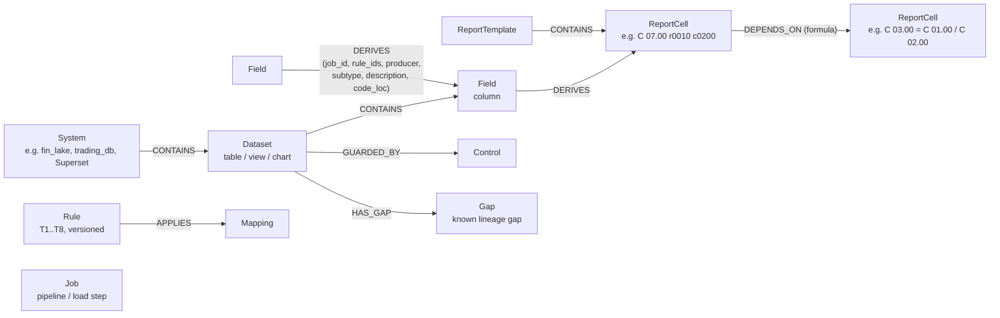
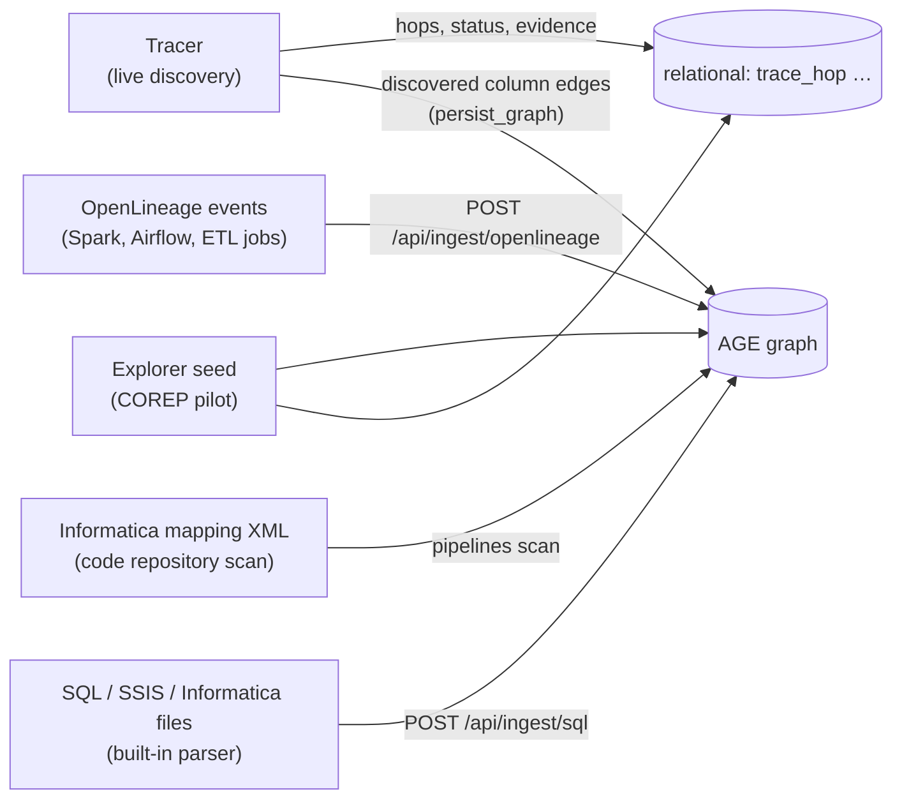

# How lineage is stored — data model & the role of Apache AGE

> **Audience:** senior architects and product managers.
> **Companion docs:** `ARCHITECTURE.md` (system overview), `KNOWN_ISSUES.md` (backlog, section D covers the repository).

---

## 1. In one paragraph

Lineage is naturally a **graph**: systems contain tables, tables contain columns, and columns *derive from* other columns through jobs and rules. We store it in **PostgreSQL 18 with the Apache AGE extension**, which adds a property-graph engine (openCypher queries) *inside* Postgres. The **graph** holds the *what-connects-to-what* (nodes and edges, with versions and validity dates). Ordinary **relational tables in the same database** hold the *facts and evidence* that are tabular by nature: trace runs, hop status and evidence, values per hop, records, audit log, credentials. One database, one backup, one transaction, two query languages (Cypher for paths, SQL for facts).

---

## 2. Why a graph at all

The questions a regulator or change team asks are **path questions**:

| Question | Shape |
|---|---|
| "Where did this number come from?" | walk *upstream* from a report cell, any depth |
| "What breaks if this source column changes?" | walk *downstream*, any depth (impact analysis) |
| "Which reports depend on this rule / mapping version?" | find all paths through an edge with a given property |
| "Show me lineage as it was on 31-Mar" | the same walks, filtered by edge validity dates |

In plain SQL these become recursive self-joins over an edge table — possible, but hard to read, write and maintain, and they get worse as edge types multiply. In a graph they are one pattern:

```cypher
-- everything upstream of a report cell, up to 10 hops, valid on 30-Jun-2026
MATCH p = (c:ReportCell {uid: $cell})<-[:DERIVES*1..10]-(src)
WITH src, [r IN relationships(p) WHERE r.valid_from > '2026-06-30' OR r.valid_to < '2026-06-30'] AS bad
WHERE size(bad) = 0
RETURN DISTINCT src.uid
```

This is also how the leading open catalogues model lineage: OpenLineage/Marquez (datasets ↔ jobs), DataHub (URN entities + lineage edges), OpenMetadata (entity relationships). Using a graph keeps us compatible with their concepts.

## 3. Why Apache AGE specifically

| Requirement | Apache AGE (chosen) | Alternatives considered |
|---|---|---|
| Open source, no vendor lock-in | Apache 2.0, Apache Software Foundation; no paid tier | Neo4j Community (GPLv3; clustering, RBAC, hot backup are Enterprise-only), Memgraph & ArangoDB (BSL licences), NebulaGraph (vendor-led) |
| Actively maintained | v1.8.0 released Sep-2026, multiple contributors | JanusGraph: last release Nov-2024, ~2 maintainers; Kuzu: archived 2025 |
| Graph **and** facts in one place | Graph lives in Postgres → join graph results with relational evidence in one SQL statement, one transaction | Separate graph DB = second system to run, sync and secure |
| Bank operability | Standard Postgres: backups, HA, row-level security, encryption, managed offerings (e.g. Azure) | New engine to certify with infra/security teams |
| Query language AI agents handle well | openCypher + SQL | Gremlin (harder for humans and LLMs) |
| Escape hatch | AGE stores vertices/edges in ordinary Postgres tables → recursive SQL is always possible if a Cypher feature is missing | — |

**Trade-off we accept:** AGE is younger than Neo4j and has Cypher gaps (e.g. `all(...)` over variable-length paths fails in 1.8 — we use list comprehensions instead). At our scale (thousands to low millions of edges, path depth ≤ 10–15) performance is not the constraint; governance and operability are.

---

## 4. The data model

### 4.1 Graph (AGE graph named `lineage`)



**Vertex labels** (all carry `uid`, `label`, `kind`, `version`, `valid_from`, `valid_to`, `recorded_at`):

| Label | Represents | Example uid | Notes |
|---|---|---|---|
| `System` | A database, file or tool | `system:fin_lake` | `lane` = position in the flow (source, staging, …) |
| `Dataset` | Table, view, chart, file | `dataset:fin_lake.core.fact_exposure` | `system_uid`, `hidden` |
| `Field` | Column | `field:fin_lake.core.fact_exposure.ead_usd` | the unit of column-level lineage |
| `Job` | A pipeline / load step | `job:m_C90_calc_sbm_charge` | Informatica mapping, Spark job, script |
| `Rule` | Business/transformation rule, versioned | `rule:T4@v3.2` | e.g. CRR article reference |
| `Mapping` | Reference mapping (e.g. product → exposure class) | `mapping:product_to_class` | versions over time |
| `ReportTemplate`, `ReportCell` | Regulatory template and its cells | `C07.00:Corporates:r0010:c0200` | the anchor of a trace |
| `Control`, `Adjustment`, `Gap` | Data-quality control, manual adjustment, known gap | `gap:haircut_table` | governance objects |

**Edge labels**:

| Label | Meaning | Key properties |
|---|---|---|
| `CONTAINS` | System → Dataset → Field; Template → Cell | — |
| `DERIVES` | Column-level lineage: source field feeds target field | `job_id` (which pipeline), `rule_ids`, `hop`, `producer` (`openlineage`, `informatica`, `spark`…), `transform_type` (DIRECT/INDIRECT), `subtype` (e.g. FILTER, AGGREGATION), `description`, `code_loc` (file), `via` (transformation name) |
| `DEPENDS_ON` | Report cell depends on other cells | `formula` (e.g. CET1 ratio = C01 / C02) |
| `APPLIES` | Rule applies a mapping | — |
| `GUARDED_BY`, `HAS_GAP` | Dataset ↔ control / known gap | — |

**Point-in-time:** every vertex and edge has `valid_from` / `valid_to` (business validity) and `recorded_at` (when we learned it). "Lineage as of 31-Mar-2026" = traverse only edges valid on that date — e.g. mapping v3.1 vs v3.2.

**Example — one real edge** written from an Informatica mapping:
```json
{ "uid": "e:DERIVES:field:frtb_engine.public.ref_risk_weight.risk_class>field:frtb_engine.public.calc_sbm_charge.consolidation_group",
  "job_id": "job:m_C90_calc_sbm_charge", "producer": "informatica", "via": "FIL_RW_FOUND",
  "transform_type": "INDIRECT", "subtype": "FILTER", "description": "group by",
  "code_loc": "pipelines/informatica/m_C90_calc_sbm_charge.xml",
  "valid_from": "2000-01-01", "valid_to": "9999-12-31", "version": 1 }
```

**Current size (sandbox):** 7 Systems · 71 Datasets · 372 Fields · 8 Rules · 10 ReportCells · 693 DERIVES edges (342 from pipeline jobs: OpenLineage/Spark, Informatica) · 388 CONTAINS.

### 4.2 Relational tables (same database)

| Group | Tables | Why relational |
|---|---|---|
| **Tracer state** | `tracer_report` (uploaded report + parsed table), `trace` (one per trace, status, header), `trace_step` (systems reached, in order), `trace_hop` (hop: from/to, status, pipeline type, columns, transformation, business rules, evidence: code, version hash, log, reconciliation) | Per-run facts; queried by id; evidence is text-heavy |
| **Discovery inputs** | `query_history` (harvested `pg_stat_statements`: query, calls, first/last seen, db, user), `vault_credential` (Fernet-encrypted credentials per system) | Time-series and secrets — not graph data |
| **Explorer facts** | `submission`, `template`, `cell_def`, `cell_value`, `hop`, `hop_value`, `run`, `control_result`, `adjustment`, `rule_version`, `mapping_version`, `mapping_row`, `record_contribution`, `record_trace` | Numbers per submission, per run, per record — large, tabular, aggregated with SUM/GROUP BY |
| **Governance** | `certification`, `gap`, `lineage_snapshot` (frozen lineage at submission, hashed, immutable), `evidence_pack` (ref, file, SHA-256), `audit_log` (append-only, hash-chained) | Immutability, retention, hashing — classic relational controls |

**The join key** between both worlds is the **`uid`** (e.g. `dataset:fin_lake.core.fact_exposure`), so a single SQL statement can combine a Cypher traversal with relational evidence.

---

## 5. How lineage gets into the store (write paths)



| Writer | What it writes | Notes |
|---|---|---|
| **OpenLineage ingest** (`ingest_ol.py`) | Dataset + Field vertices, DERIVES edges with `job_id`, `producer`, column-lineage `subtype/description`, `code_loc` | Spark listener events, FX feed job |
| **Pipeline scan** (Informatica mappings) | Same shape, `producer = informatica`, expressions composed along the transformation chain | Connection names resolved via `connections.xml` |
| **SQL/XML parser ingest** (`ingest_sql.py`) | Dataset/Field vertices + DERIVES from parsed SQL/SSIS/Informatica files | Design-time lineage from code |
| **Tracer** (`persist_graph`) | Column DERIVES edges for every hop it discovered | Best-effort today — see KNOWN_ISSUES D1 |
| **Explorer seed** | Full pilot graph: systems, datasets, fields, rules (versioned), report cells, controls, gaps | Demo data |

All writes are **idempotent upserts keyed by `uid` + `version`** — re-ingesting the same event or file changes nothing.

## 6. How lineage is read (read paths)

| Reader | Uses the graph for | Uses relational for |
|---|---|---|
| **Tracer** | Looks up **pipeline jobs** that wrote a table (DERIVES with `job_id`) when the database itself has no writer — this is how Spark and Informatica hops are found; dataset namespaces for cross-system jumps | Trace state, hops, evidence, vault, query history |
| **Explorer — reverse lineage (S03)** | Path from report cell to sources, point-in-time filtered, system/dataset/attribute levels via CONTAINS | Hop details, values, controls |
| **Explorer — forward impact (S10–S12)** | Downstream traversal + DEPENDS_ON formulas (e.g. CET1 ratio) | Contributions per cell, thresholds |
| **Explorer — search** | Vertex names/keywords (pg_trgm on the vertex table) | — |

---

## 7. Honest current state vs target state

**Today:** the graph is the shared repository for *design-time* and *pipeline* lineage (parsed code, OpenLineage, Informatica, Explorer seed) and the Tracer **reads** it to find pipeline jobs. The Tracer's own results (hop **status**, **evidence**, **business rules**) are stored relationally; only the discovered column edges are copied to the graph, without status or validity dates.

**Target (backlog D1–D4):**
1. Every trace writes hop status, pipeline type, evidence reference and validity dates onto the DERIVES edges, plus a `Job` vertex per pipeline run with `READS`/`WRITES` edges (OpenLineage model).
2. The graph becomes the single answer to "what is the current, proven lineage of X", while relational tables keep the immutable evidence and run facts.
3. The Explorer screens read tracer-discovered lineage instead of seeded data.
4. Forward impact in the Tracer becomes a graph traversal.

## 8. Scale & operations
- Expected size per bank: 10⁴–10⁶ fields, 10⁵–10⁷ edges; path depth ≤ 15. Well within Postgres/AGE capability; indexes on `uid` and on edge properties used in filters.
- Backup/HA/DR, encryption at rest and access control are standard Postgres — no new platform for infrastructure teams.
- If one day traversal volume demands a dedicated graph engine, the model (labels, uids, edge properties) maps 1:1 to any property-graph database; the `uid` contract keeps the relational side unchanged.
